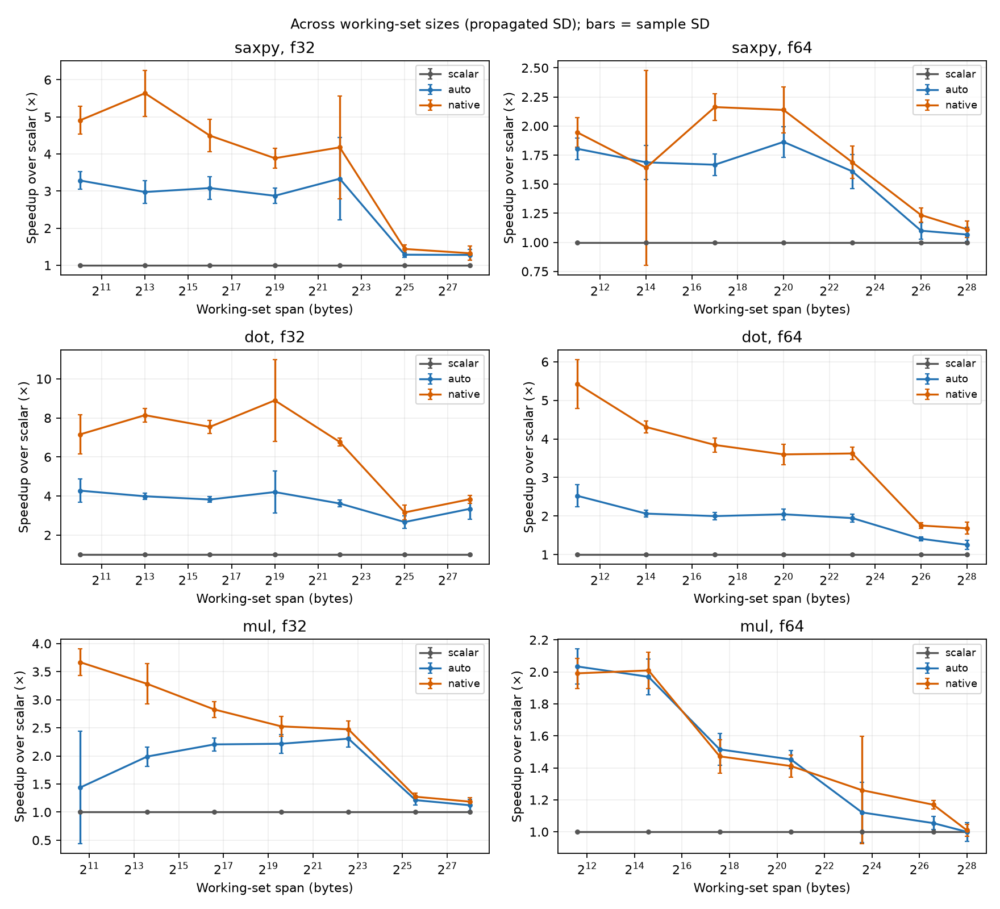
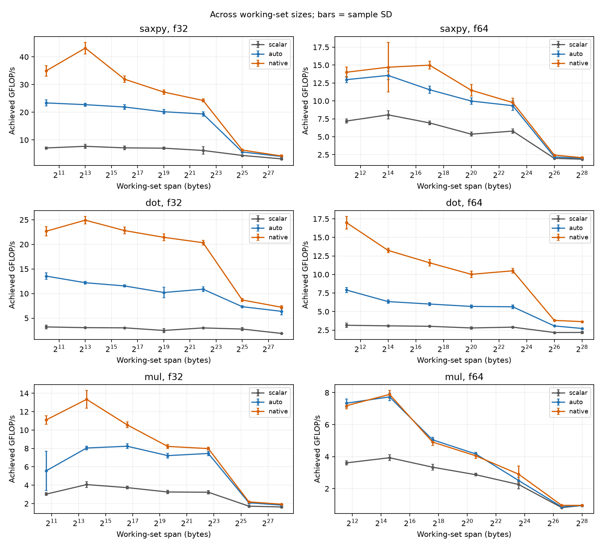
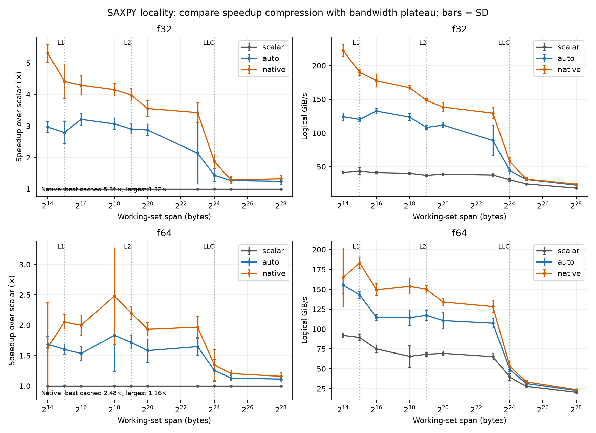
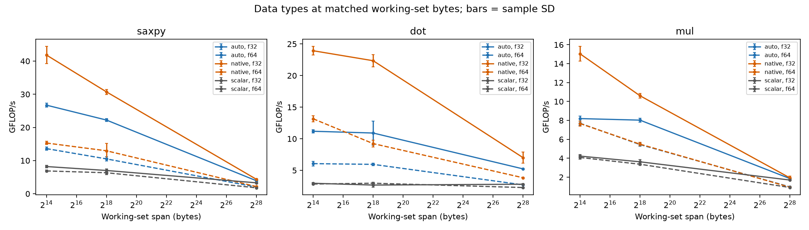
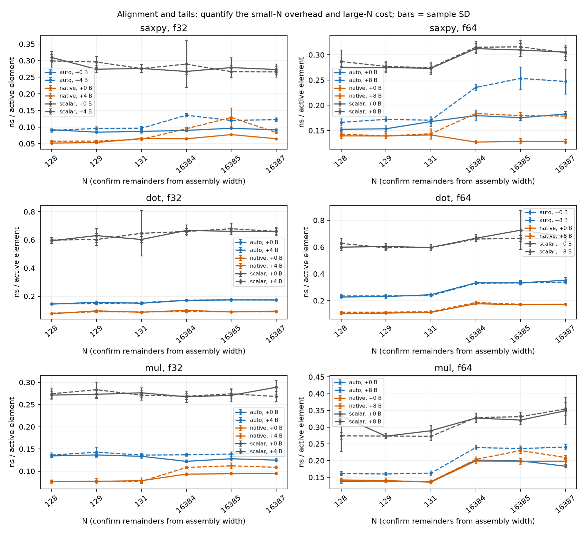
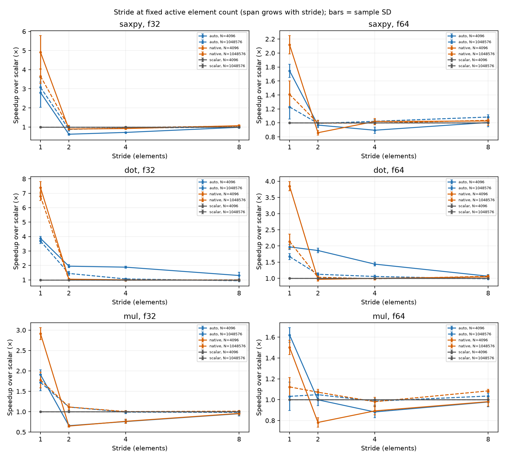
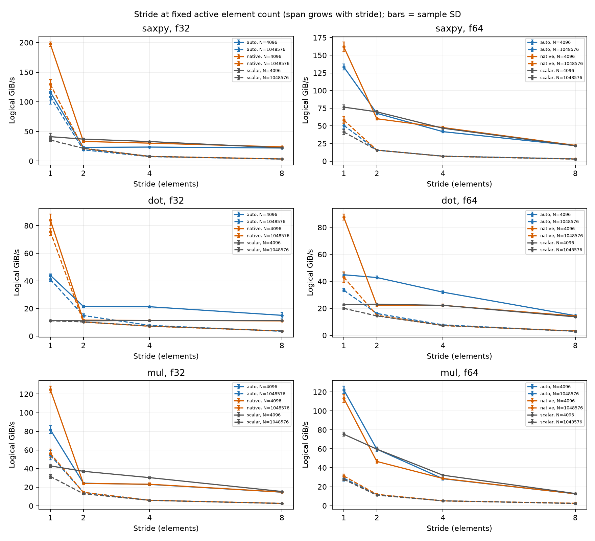
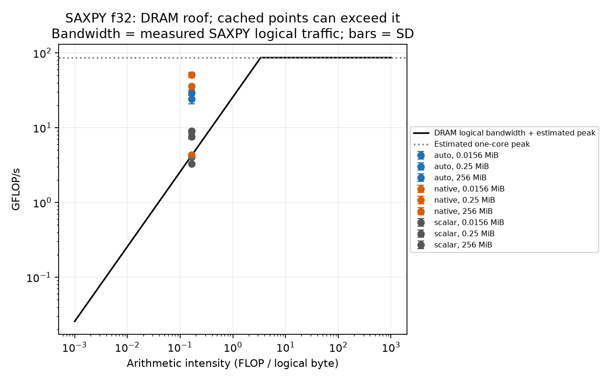
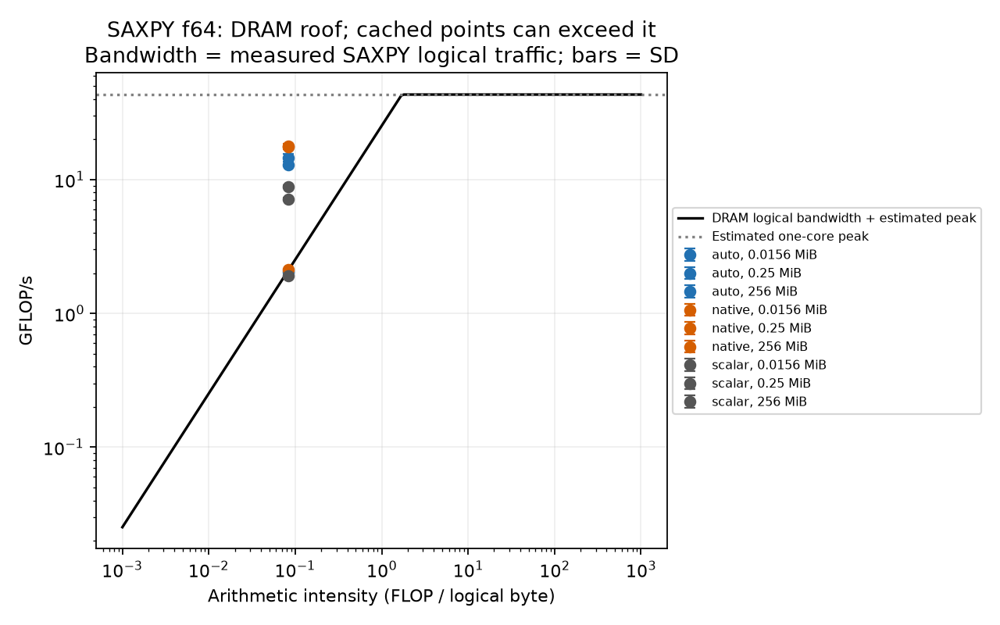
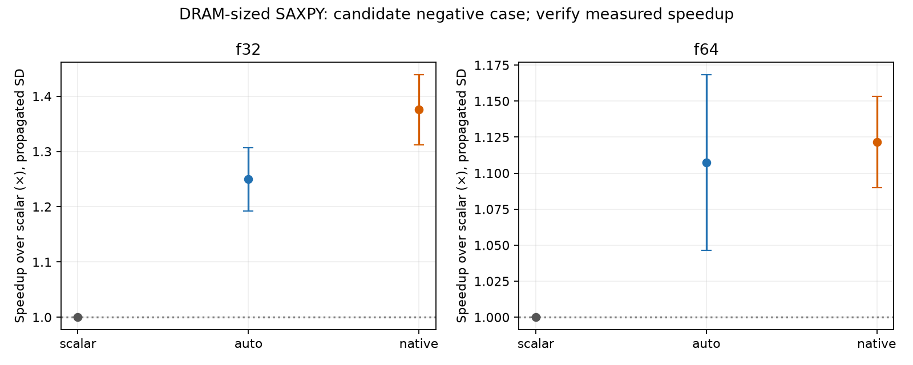

# Project 1: SIMD

## Objective and Hypothesis

Benchmark scalar, auto-vectorized, and CPU-targeted SIMD SAXPY, dot product, and elementwise multiplication for float32/float64. Expected: SIMD-vectorized code to perform faster than scalar code because it can process multiple data elements at once. However, as the dataset becomes larger and memory bandwidth becomes a limiting factor, the performance improvement from SIMD will decrease.

## Method and validation

Ran single-threaded experiments on Ryzen 7 PRO 7735U (AVX2/FMA) in WSL2 Linux 6.18, g++ 13.3.0, C++17 -O3. Builds: scalar (-fno-tree-loop-vectorize -fno-tree-slp-vectorize), auto (loop/SLP vectorization), native (-march=native -mtune=native). Recorded L1D/L2/L3: 32 KiB/512 KiB per core, 16 MiB shared. Deterministic initialization, warmed kernel-only timing, pinned runs where available, nine repetitions and sample variability. Correctness checks passed 1,302 reference/guard cases plus 13 invalid-argument cases. GCC vectorization reports and 256-bit AVX/FMA disassembly verify SIMD in selected kernel paths; scalar report is empty.

## Core performance and locality

For native float64 SAXPY, speedup is 2.16x at N=8,192, 1.23x at N=4,194,304, and 1.11x at N=16,777,216. The gain and throughput drop with footprint suggest growing memory-system pressure. Cache boundaries help interpret the trends but do not prove exact place of each access.

Figures 1–4 show scalar-relative speedup, achieved throughput, locality, and float32/float64 results.

## Alignment, tail and stride

At N=16,384 for native float64 SAXPY, aligned speedup is 2.46x versus 1.71x with an 8-byte shift; tail effects vary with length. For auto float32 dot at N=1,048,576, speedup decreases from 3.69x (stride 1) to 0.94x (stride 8). Striding reduces useful data per fetched cache line and impedes efficient vector accesses.

## Roofline and negative example

SAXPY: 2 FLOPs per element and approximately 3 reads/writes of an element-size worth of logical traffic: 0.167 FLOP/logical byte for float32 or 0.083 for float64. The nominal single-core compute roofs, 86.4 and 43.2 GFLOP/s, assume 2.7 GHz, 256-bit vectors, two FMA units/cycle, and 2 FLOPs/FMA lane; sustained peak was not measured. The bandwidth roof is calibrated using separately measured attained SAXPY logical traffic, NOT a physical DRAM counter. Cache-resident points may exceed this approximate memory roof.

Negative case: native float64 SAXPY at N=16,777,216 is only ~1.12× faster than scalar. This is compatible with a memory-pressure limit, but does not establish DRAM saturation independently. WSL scheduling, frequency variation, caching, and unavailable hardware cycle counters limit attribution; cycles/element were not reported.

## Limitations and Conclusion

The experiments conducted under WSL2, may introduce scheduling and timing variability. CPU frequency was not fixed, and hardware performance counters were unavailable, limiting the ability to measure actual memory traffic and cycles per element. The roofline analysis used estimated peak CPU performance and measured logical bandwidth rather than physical DRAM bandwidth. Therefore, memory-bandwidth saturation cannot be confirmed directly.

SIMD gains were real but sensitive to locality, alignment, stride, and data type. Larger working sets and scattered memory accesses showed smaller improvements, suggesting that memory-system limitations can reduce the benefits of vectorization.