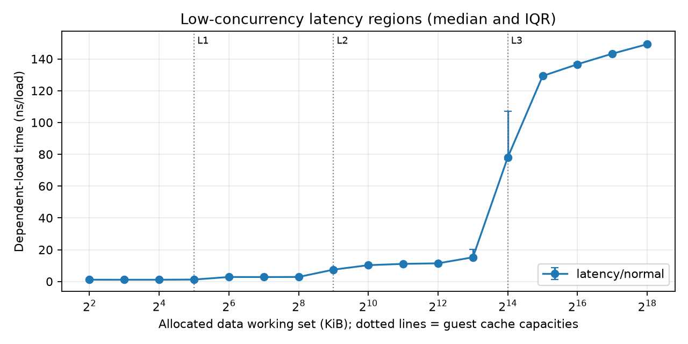
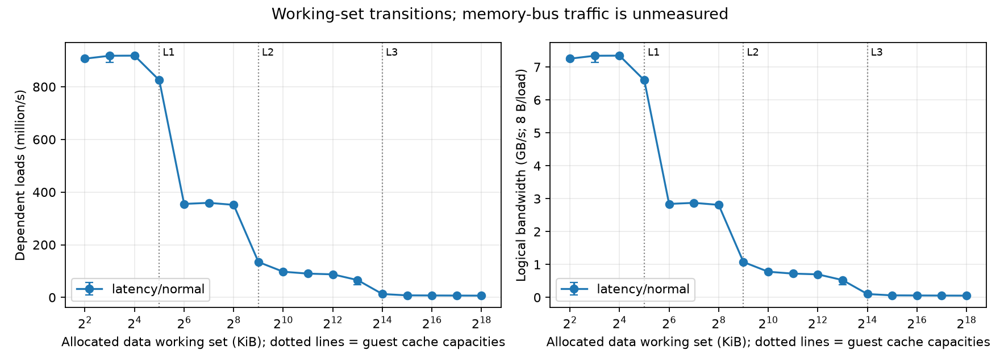
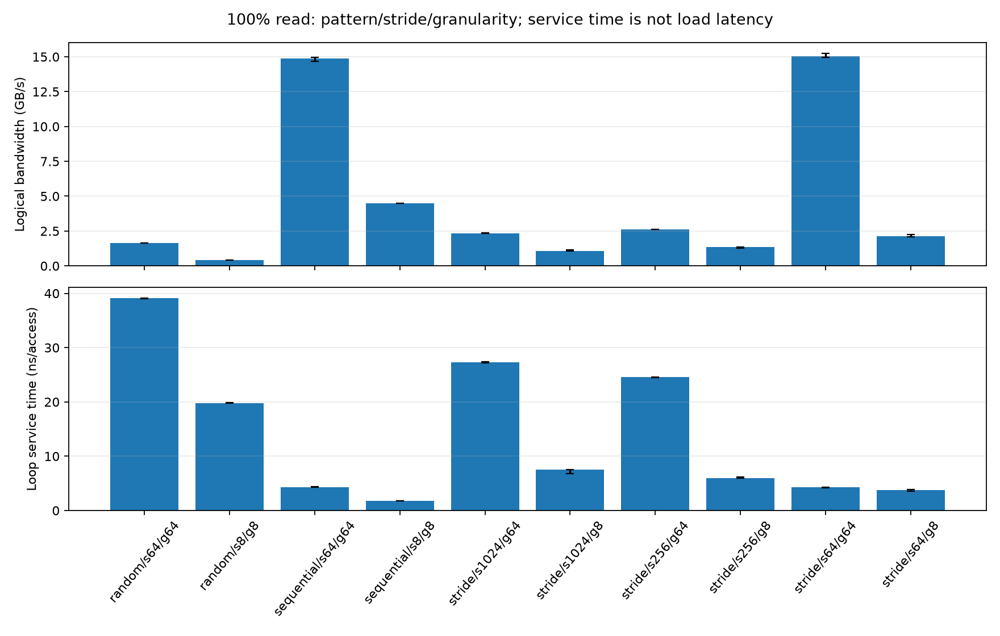
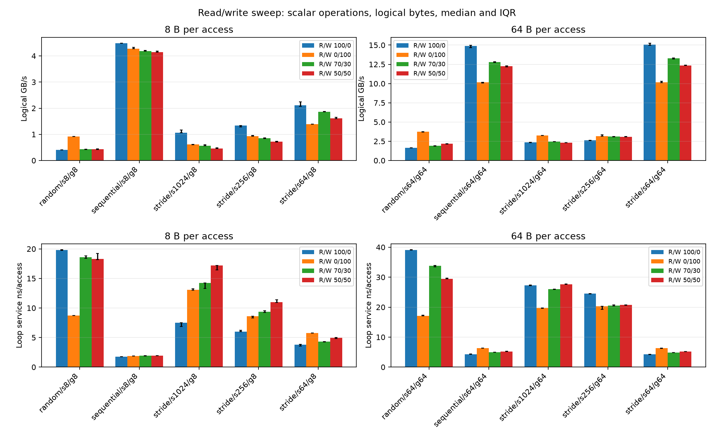
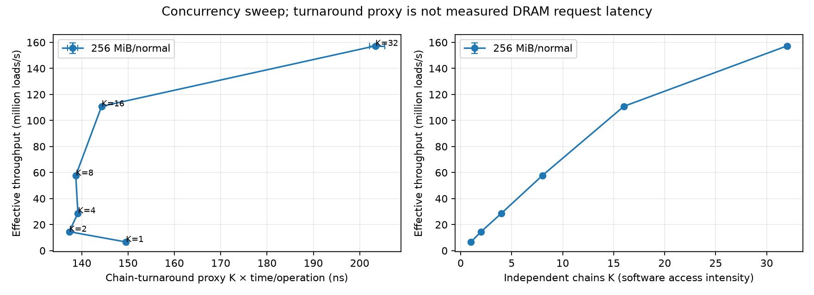
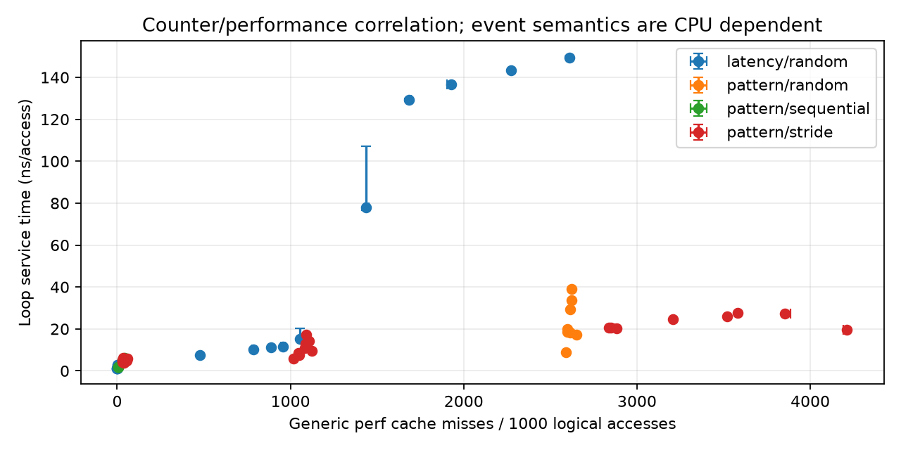
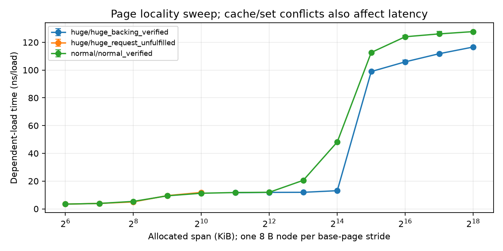
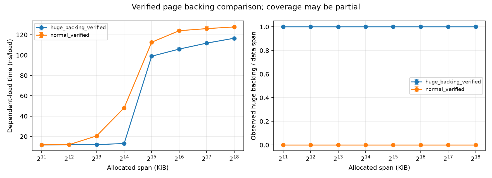
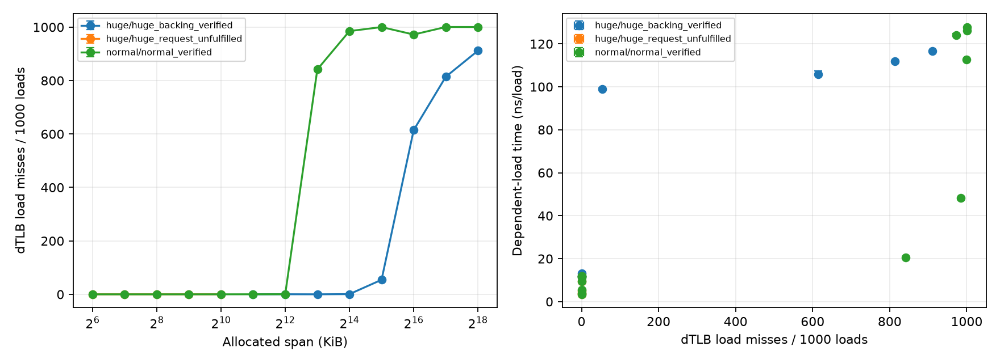
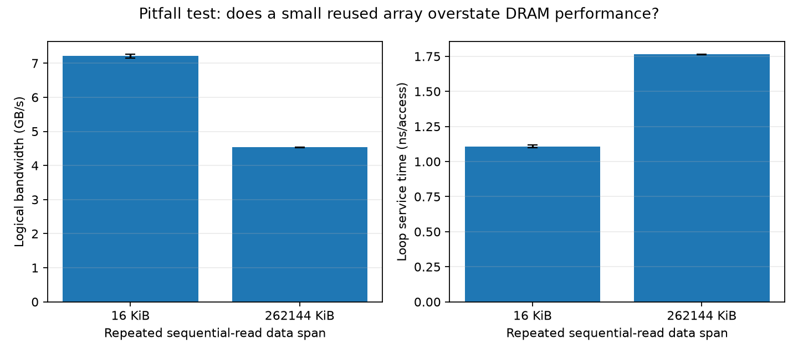

# Project 2: Cache & Memory Profiling

## 1. Objective and hypothesis

This project measures how cache size, access pattern, memory-level parallelism, read/write mix, and page size affect memory latency and throughput. Expected: Memory access latency to increase as the working-set size grows beyond the capacity of each cache level. Sequential memory access should provide better performance than random access, while increasing memory request intensity should improve throughput until saturation is reached.

## 2. Method and validation

Experiments ran under Ubuntu 24.04.4 on WSL2 on an AMD Ryzen 7 PRO 7735U, 8 cores / 16 threads. Reported cache capacities were 32 KiB L1 data per core, 512 KiB L2 per core, and 16 MiB shared L3. The C++17 benchmark was compiled with g++ -O3 -std=c++17 -Wall -Wextra -Wpedantic. Runs targeted CPU 0 with affinity, used two warmups, five repetitions, a 100 ms target duration and deterministic seed 42. No system-level CPU isolation, frequency or SMT changes were made. Working sets reached 256 MiB. Measurements are summarized using medians, with the underlying CSV retaining repeat-level data and variability.

## 3. Cache and DRAM latency

| Working set | Median latency |
|---|---:|
| 16 KiB | 1.09 ns |
| 64 KiB | 2.82 ns |
| 512 KiB | 7.44 ns |
| 8 MiB | 15.20 ns |
| 16 MiB | 78.08 ns |
| 256 MiB | 149.23 ns |

Latency rises as footprint exceeds the lower-level caches and then the effective last-level-cache capacity. The sharp rise around 16 MiB is consistent with increased DRAM exposure, although cache sharing, access order and TLB effects prevent exact attribution of every boundary.

## 4. Access patterns and read/write mixes

For a 256 MiB working set and 100% reads, sequential 8-byte accesses achieved 4.48 GB/s logical throughput, versus 0.40 GB/s for random 8-byte accesses. With 8-byte operations, a 64-byte stride achieved 2.11 GB/s, decreasing to 1.33 GB/s at 256 bytes and 1.07 GB/s at 1024 bytes. Sequential locality favors caching and prefetch. Sparse/random accesses waste cache-line transfers and increase misses.

The read/write sweep includes 100% read, 100% write, 70/30, and 50/50 mixes. Throughput depends on both the mix and access pattern. Write-only and mixed results should not be interpreted as equivalent to read-only latency.

## 5. Throughput–latency knee and Little’s Law

At 256 MiB, increasing independent pointer chains from 1 to 32 increased throughput from 6.69 to 157.33 million operations/s. The final 16 to 32 increase improved throughput by only 41.9% despite doubling concurrency, while per-chain turnaround rose from approximately 144 to 203 ns. This indicates diminishing returns near the highest measured intensity; it does not establish a precise saturation knee beyond intensity 32.

Little’s Law is outstanding operations = completion rate * mean time in system. At intensity 32, 157.33 million ops/s * 203.40 ns is approximately 32, consistent with the independent-chain model. Chain turnaround is used for this relationship; dividing total time by all operations would instead report a throughput-based service interval, not per-request latency.

## 6. Cache/TLB misses and page size

Cache-miss measurements generally increase with large, sparse working sets and help explain rising latency. The results also contain TLB-miss counters; those counters are workload and event definition dependent and should not be treated as universal DRAM traffic measurements.

Huge-page evidence in the processed data shows confirmed huge-page backing (fraction 1.0) for selected larger test cases. With 4 KiB-spaced random accesses, the 8 MiB working set measured 20.56 ns on normal pages versus 11.92 ns on huge pages, at 16 MiB; 48.18 ns versus 13.08 ns. This supports reduced address-translation overhead under these conditions, but cache interactions also contribute; huge-page hints below the supported threshold did not always yield huge-page backing.

## 7. Misleading example

Repeated sequential reads from a 16 KiB array achieved 7.22 GB/s, while a 256 MiB array achieved 4.54 GB/s. The small array remains cache-friendly, so calling its result “DRAM bandwidth” is misleading.

## 8. Limitations and conclusion

The experiment used WSL2 and CPU affinity but not dedicated CPU isolation or controlled clock frequencies; some absolute latency and counter values may therefore vary. The throughput knee was approached but not rigorously bracketed beyond 32 chains. Reported GB/s is logical benchmark throughput, not physical DRAM bandwidth. Under those limits, the data shows clear locality penalties, strong benefits from concurrent memory requests, and meaningful TLB/page-size effects on sparse large-array access.

