# Project 3: SSD Performance Profiling

## 1. Objective and hypothesis

This project measures SSD latency, throughput, and IOPS across block sizes, access patterns, read/write mixes, queue depths, and working-set sizes using fio. Expected: larger blocks to improve sequential throughput, and higher queue depths to increase IOPS until saturation. Beyond that point, latency should rise with limited additional throughput.

## 2. Method and validation

Tests used a reported Samsung MZVL8512HDLU-00BLL 512 GB NVMe SSD through Ubuntu on WSL2, with an AMD Ryzen 7 PRO 7735U and fio. A single job accessed an 8 GiB disposable file on ext4. Each configuration used a 3-second warmup, 20-second measurement, and three repetitions. Direct I/O was enabled except in the intentional buffered-I/O comparison. Generated workloads used `refill_buffers=1` and `scramble_buffers=1`.

All 210 recorded measurement jobs passed validation. The plots report trial means with sample-standard-deviation error bars. Latency is fio total latency and reported percentiles are averages of trial percentiles rather than pooled I/O percentiles. These tests measure the WSL2 virtualized storage path, not the physical NVMe controller alone.

## 3. QD=1 baseline

| Workload | IOPS | MiB/s | Mean latency (us) | p95 (us) | p99 (us) |
|---|---:|---:|---:|---:|---:|
| Random read, 4 KiB | 7,415 | 28.96 | 133.23 | 175.10 | 213.33 |
| Random write, 4 KiB | 7,921 | 30.94 | 123.87 | 173.06 | 207.87 |
| Sequential read, 128 KiB | 4,822 | 602.77 | 207.49 | 299.69 | 350.21 |
| Sequential write, 128 KiB | 5,341 | 667.58 | 176.83 | 215.38 | 275.46 |

Sequential requests achieved much higher bandwidth because each I/O transferred more data. Random writes were slightly faster than random reads in this test, but the result should not be generalized beyond this storage setup.

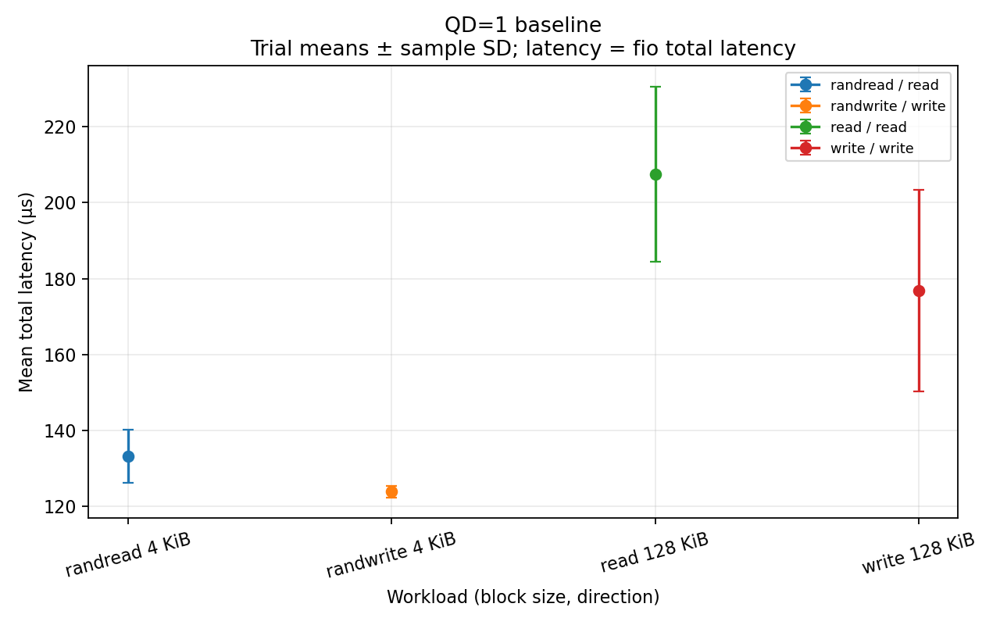

## 4. Block size, access pattern, and read/write mix

At QD=8, block sizes increased from 4 to 256 KiB. Sequential-read throughput rose from about 157 to 2,823 MiB/s; random reads reached 1,862 MiB/s. Write throughput leveled off or declined at larger block sizes, while write latency increased sharply. Larger requests therefore did not improve every workload.

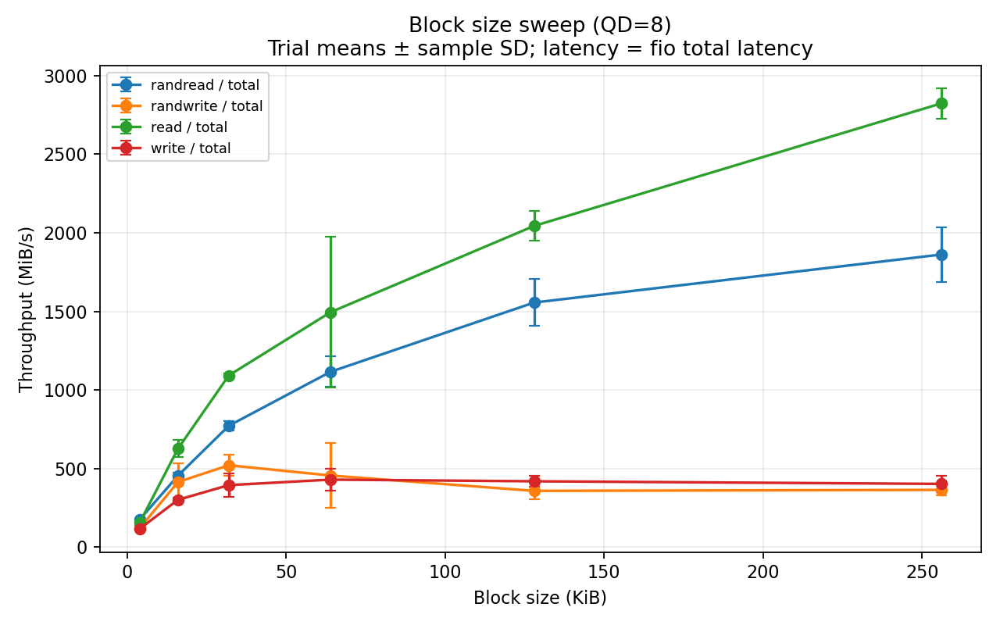

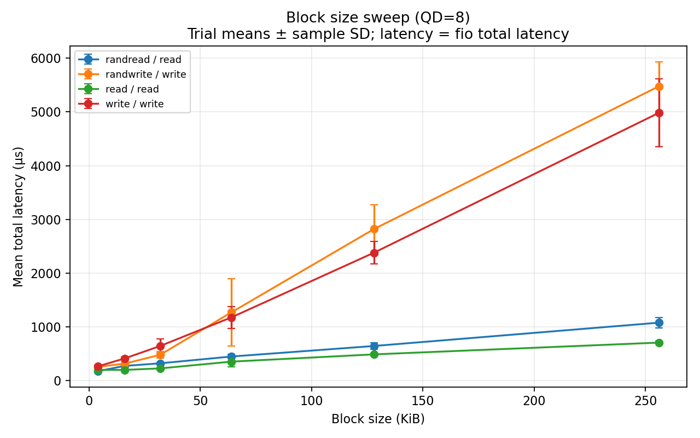

For 4 KiB random I/O at QD=8, 100% reads reached 187.57 MiB/s and 166.47 us mean latency. The 70/30 and 50/50 read/write mixes reached 165.50 and 168.65 MiB/s, while 100% writes reached 134.57 MiB/s and 230.81 us. Reads were generally faster, but the mixed-workload trend was not strictly linear.

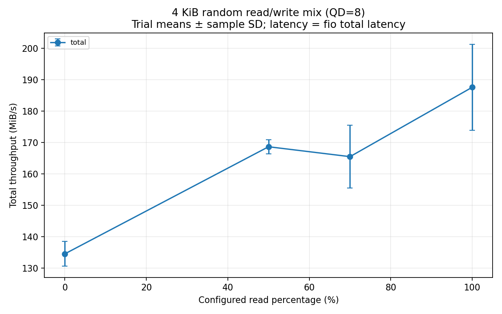

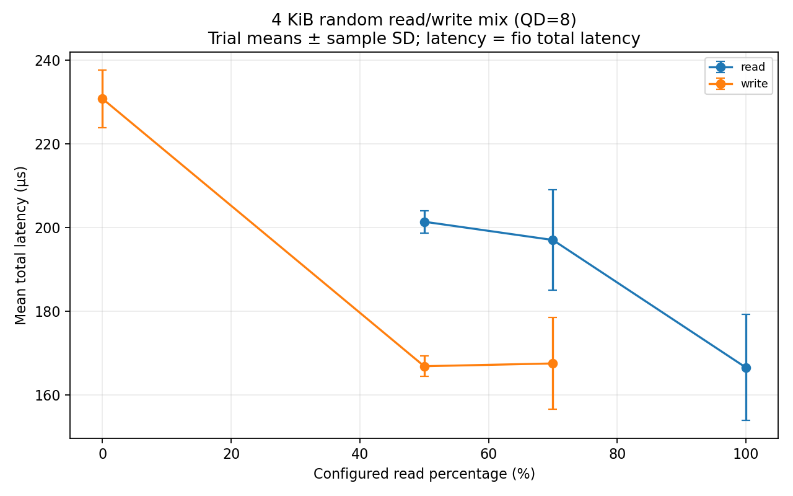

## 5. Queue depth, throughput–latency knee, and Little's Law

For 4 KiB random reads, increasing QD from 1 to 16 raised performance from 6,418 to 72,202 IOPS. At QD=32, throughput reached only 75,301 IOPS, a 4.3% increase, while latency rose from about 222 to 428 us. The random-read knee is therefore approximately between QD=16 and 32. QD=64 reached 86,859 IOPS but with about 744 us latency.

Random writes peaked near 34,462 IOPS at QD=16. Sequential workloads reached different plateaus. In particular, sequential-read throughput in the queue-depth run was much lower than in the separate block-size run, so these sessions cannot establish a reliable physical interface ceiling.

Little's Law relates the average number of outstanding requests to completion rate and response time: \(L = \lambda W\). At random-read QD=16, \(72{,}202 \times 0.00022153 \approx 16\), consistent with the expected number of outstanding operations. This does not directly measure the controller's internal queue.

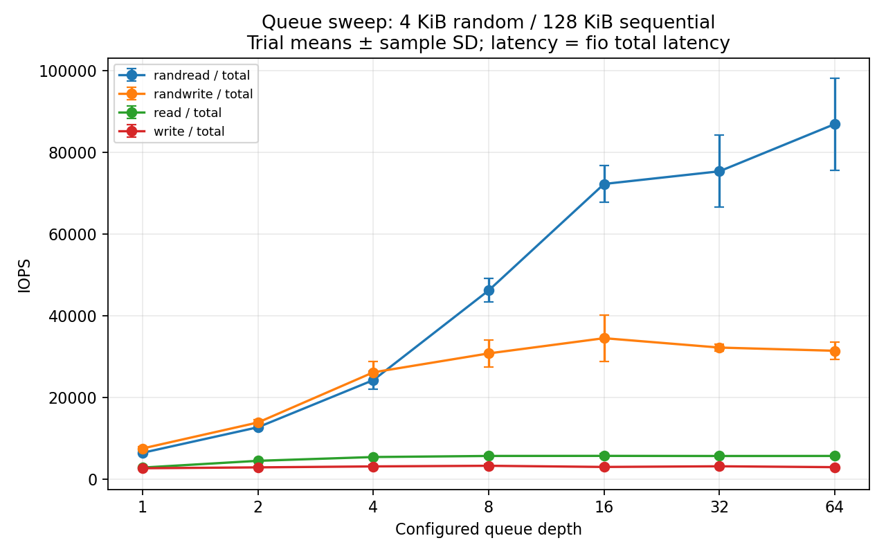

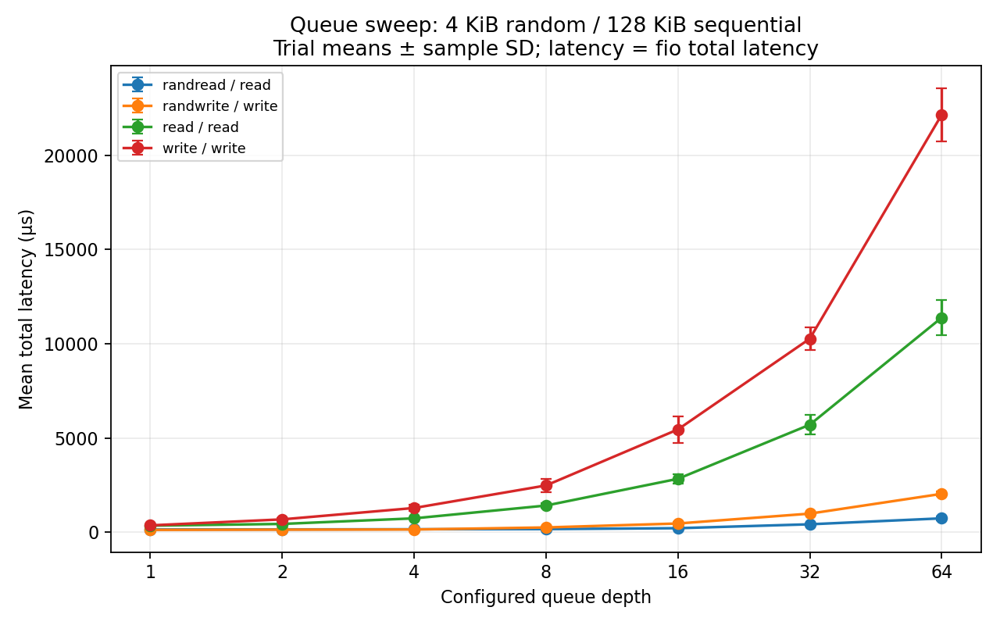

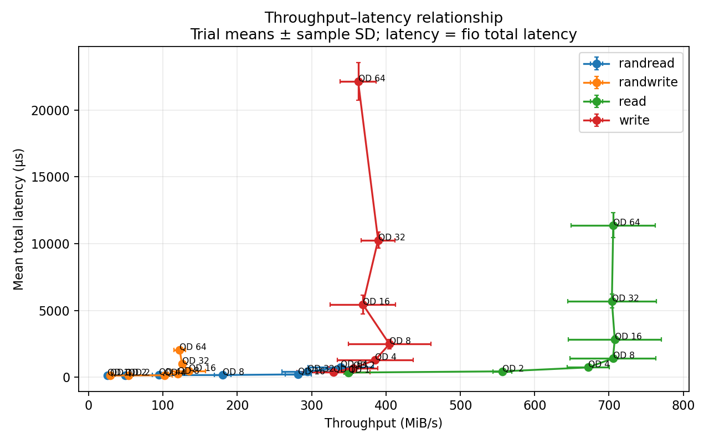

## 6. Tail latency and working-set size

For 4 KiB random reads, raising QD from 8 to 16 increased p99 latency from 317.44 to 393.90 us and p99.9 from 422.57 to 548.18 us (about 30%). Higher concurrency therefore increased slow-request delays as well as average latency. A separate sequential-write baseline trial had a 30.5 ms p99.9 outlier; the cause was not verified.

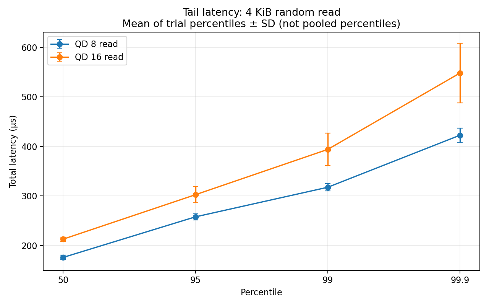

For 4 KiB random I/O at QD=8, the accessed range grew from 1 to 8 GiB. Random-read throughput decreased from 208.26 to 197.31 MiB/s (about 5.3%), while random-write throughput remained near 125–128 MiB/s. No clear cache-capacity transition was identified. SSD temperature, garbage collection, and long-run steady-state behavior were not measured.

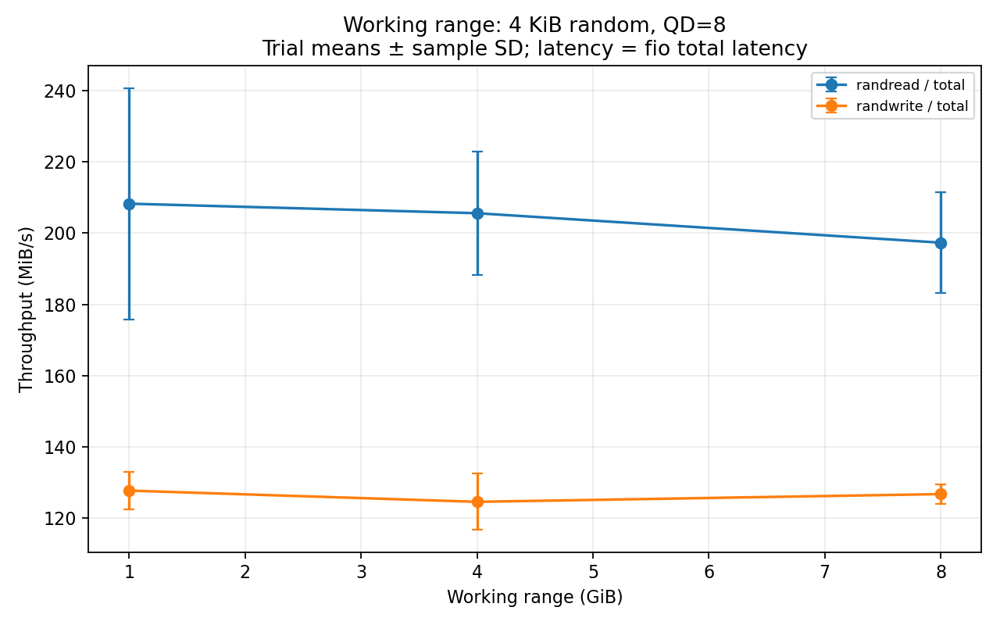

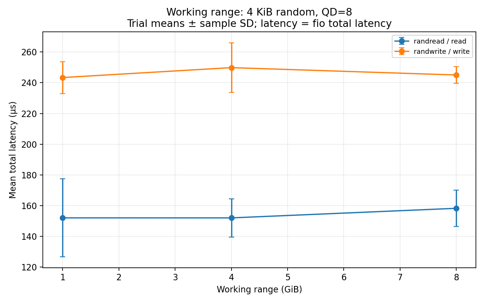

## 7. Misleading example

For 4 KiB random reads at QD=1 over 256 MiB, warmed buffered I/O reached 450,323 IOPS (1,759.07 MiB/s), compared with 6,663 IOPS (26.03 MiB/s) using direct I/O. Buffered I/O appeared 67.6 times faster because the operating-system page cache could serve reads. It would be misleading to report this as SSD hardware performance.

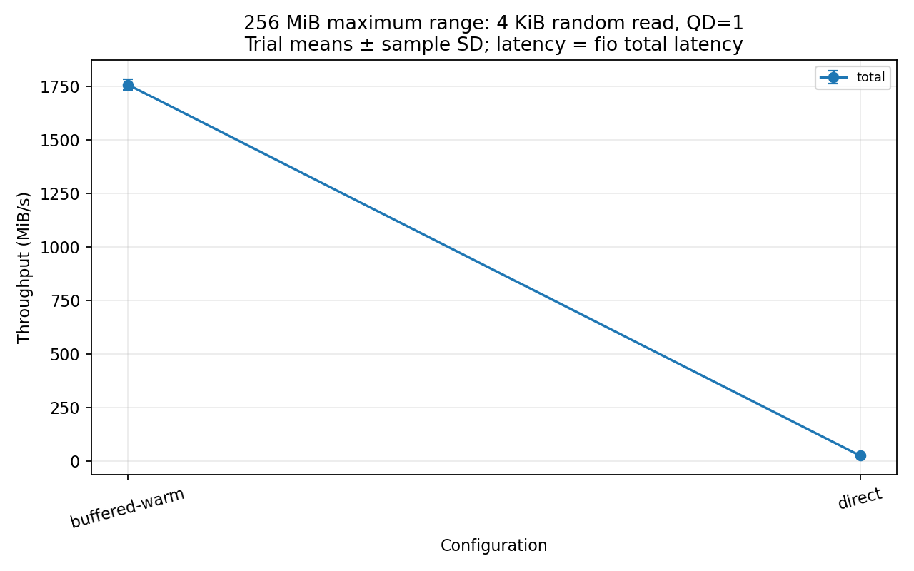

## 8. Limitations and conclusion

The main limitation is that WSL2, ext4, and the Windows host affect the measured storage path. Runs used three repetitions and short measurement windows, without dedicated CPU/host isolation or SSD temperature and garbage-collection telemetry. Raw fio results, processing scripts, configurations, and execution metadata should be retained alongside this report for reproducibility.

Overall, higher queue depth increased random-read throughput but also latency, larger blocks strongly improved sequential reads, and large write requests showed diminishing returns. The buffered-I/O comparison demonstrates why caching and the measurement path must be controlled when interpreting SSD results.
